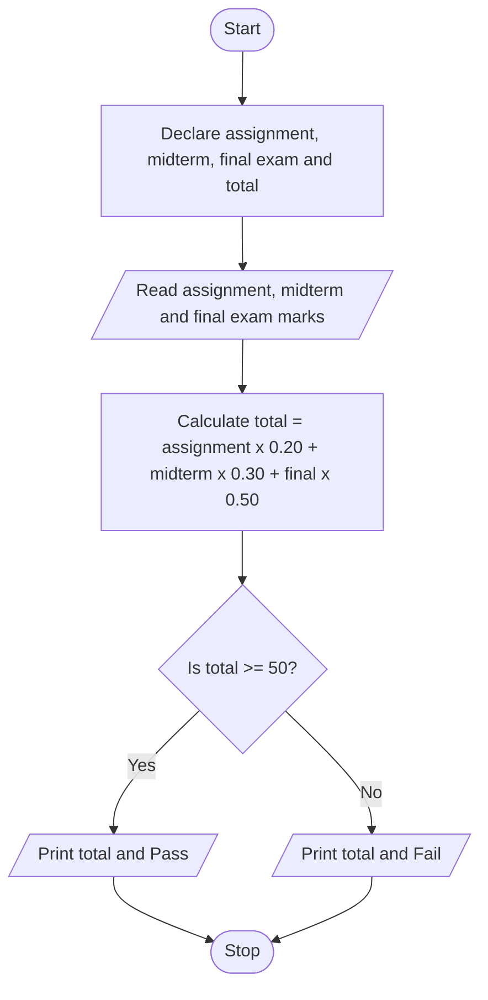
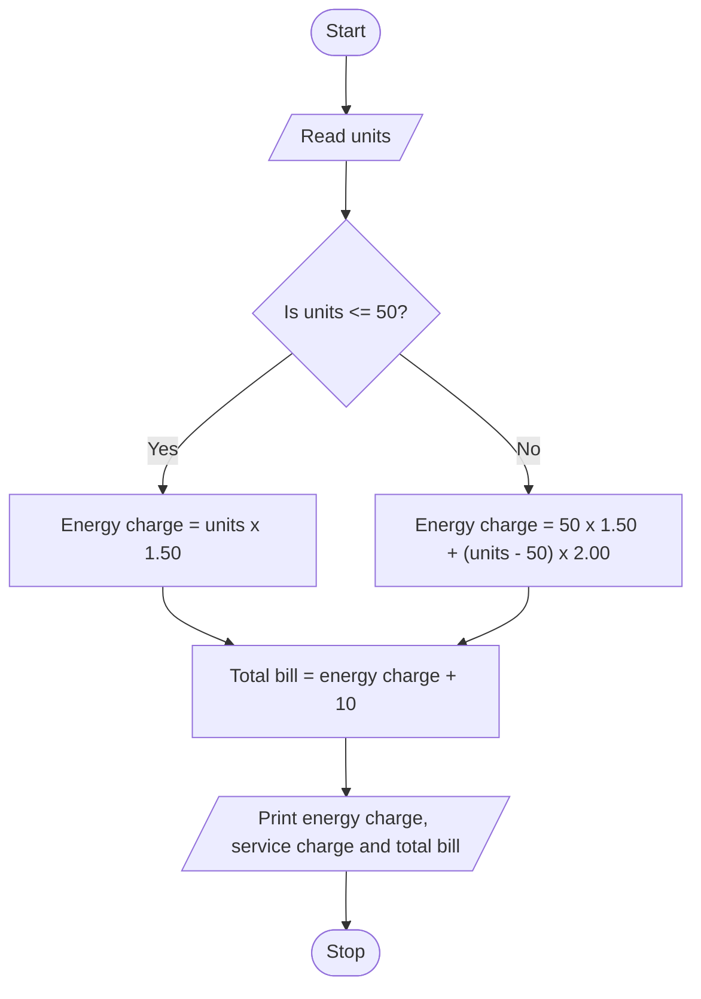
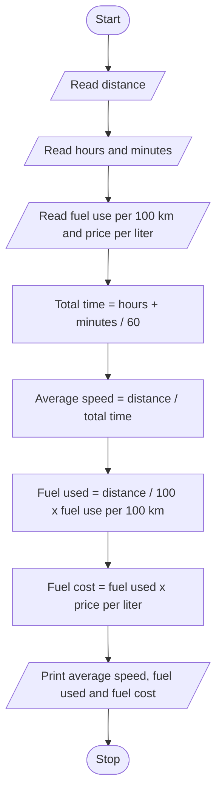

## (a) Inputs and outputs
**Inputs:**

-student Assignment mark

-student Midterm mark 

-student Final exam mark 

**Outputs:**

-The course total, shown to 1 decimal place

-The word Pass if total is 50 or above, or Fail if total is below 50

## (b) Process 

1.start the program

2.Declare variables for assignment, midterm, final exam, and total.

2.Ask the user to enter the assignment mark and read it.

3.Ask the user to enter the midterm mark and read it.

4.Ask the user to enter the final exam mark and read it.

5.Calculate the total: total = (assignment x 0.20) + (midterm x 0.30) + (final x 0.50)

6.Use the conditional operator to choose Pass ? total >= 50:Fail.

7.Print the total with 1 decimal place, and print Pass or Fail.

9.End the program.

### (c) Design the program

** Variables: what and how?**

Variable	Type	Why this type

assignment	double	Marks can have decimals.

midterm	double	Marks can have decimals.

finalExam	double	Marks can have decimals.

total	double	The weighted result has decimals.

**constants**

const double ASSIGNMENT_WEIGHT = 0.20;

const double MIDTERM_WEIGHT = 0.30;

const double FINAL_WEIGHT = 0.50;

const double PASS_MARK = 50.0;

**reading the input**

cout << "Enter assignment mark (out of 100): ";

cin >> assignment;

cout << "Enter midterm mark (out of 100): ";

cin >> midterm;

cout << "Enter final exam mark (out of 100): ";

cin >> finalExam;

**calculation**

total = (assignment * ASSIGNMENT_WEIGHT) + (midterm * MIDTERM_WEIGHT) + (finalExam * FINAL_WEIGHT);

**printing the result**

cout << fixed << setprecision(1);

cout << "Total: " << total << endl;

cout << "Result: " << ((total >= PASS_MARK) ? "Pass" : "Fail") << endl;

### Flowchart

### Test Example

Input: assignment 80, midterm 70, final exam 90

Output: Total: 82.0, Result: Pass

## Task 2: Electricity Bill

### (a) Inputs and Outputs

**Input:**

- Electricity units used in a month (kWh, a whole number)

**Outputs:**

- Energy charge (2 decimal places)

- Service charge — fixed 10.00 birr

- Total bill (2 decimal places)

### (b) Process

1. Start the program.

2. Declare the rates: first rate 1.50, second rate 2.00, first limit 50, and the service charge 10.00.

3. Ask the user to enter the electricity units used and read the units.

4. Use the conditional operator: if the units are 50 or less, energy charge = units x 1.50.

5. Otherwise, energy charge = 50 x 1.50 + (units - 50) x 2.00.

6. Calculate the total bill = energy charge + service charge.

7. Print the energy charge, the service charge, and the total bill with 2 decimal places.

8. End the program.

#### Design the program

 **Variables: what and how?**

Variable	Type	Why this type

units	int	Electricity units are whole numbers.

energyCharge	double	Money results have decimals.

totalBill	double	Money results have decimals.

**constants**

const double FIRST_RATE = 1.50;

const double SECOND_RATE = 2.00;

const double SERVICE_CHARGE = 10.00;

const int FIRST_LIMIT = 50;

**reding the inputs**

cout << "Enter electricity units used (kWh): ";

cin >> units;

**calculation**

energyCharge = (units <= FIRST_LIMIT) ? (units * FIRST_RATE)
               : ((FIRST_LIMIT * FIRST_RATE) + ((units - FIRST_LIMIT) * SECOND_RATE));

totalBill    = energyCharge + SERVICE_CHARGE;

**printing the result**

cout << fixed << setprecision(2);

cout << "Energy charge: " << energyCharge << " birr" << endl;

cout << "Service charge: " << SERVICE_CHARGE << " birr" << endl;

cout << "Total bill: " << totalBill << " birr" << endl;

### Flowchart

### Test Examples

Test 1 — Input: 80 units

Output: Energy Charge: 135.00 birr, Service Charge: 10.00 birr, Total Bill: 145.00 birr

Test 2 — Input: 30 units

Output: Energy Charge: 45.00 birr, Service Charge: 10.00 birr, Total Bill: 55.00 birr

## Task 3: Trip Speed and Fuel Cost

### (a) Inputs and Outputs

**Inputs:**

- Distance of the trip (km)

- Travel time — hours and minutes (whole numbers)

- Fuel use of the car (liters per 100 km)

- Price of fuel per liter (birr)

**Outputs:**

- Average speed (km/h, 2 decimal places)

- Fuel used (liters, 2 decimal places)

- Fuel cost (birr, 2 decimal places)

### (b) Process

1. Declare variables for distance, hours, minutes, fuel use per 100 km, and price per liter.

2. Ask the user to enter the distance and read it.

3. Ask the user to enter the travel time as hours and minutes and read them.

4. Ask the user to enter the fuel use per 100 km and read it.

5. Ask the user to enter the price per liter and read it.

6. Convert the time to hours only: total time = hours + (minutes / 60), using casting so the division gives a decimal.

7. Calculate the average speed: average speed = distance / total time.

8. Calculate the fuel used: fuel used = (distance / 100) x fuel use per 100 km.

9. Calculate the fuel cost: fuel cost = fuel used x price per liter.

10. Print the average speed, the fuel used, and the fuel cost, each with 2 decimal places.

#### Design the program

**Variables: what and how?**

Variable	Type	Why this type

distance	double	Distance in km can have decimals.

hours, minutes	int	Time is entered as whole hours and whole minutes.

fuelUsePer100Km	double	Fuel use can have decimals, like 7.5.

pricePerLiter	double	Prices have decimals.

totalTime, averageSpeed, fuelUsed, fuelCost	double	Calculated results have decimals.
 

there is no constant here

**reading the input**

cout << "Enter distance of the trip (km): ";

cin >> distance;

cout << "Enter travel time (hours and minutes): ";

cin >> hours >> minutes;

cout << "Enter fuel use (liters per 100 km): ";

cin >> fuelUsePer100Km;

cout << "Enter price per liter (birr): ";

cin >> pricePerLiter;

**calculation**

totalTime    = hours + (static_cast<double>(minutes) / 60);

averageSpeed = distance / totalTime;

fuelUsed     = (distance / 100) * fuelUsePer100Km;

fuelCost     = fuelUsed * pricePerLiter;

**printing the result**

cout << fixed << setprecision(2);

cout << "Average speed: " << averageSpeed << " km/h" << endl;

cout << "Fuel used: " << fuelUsed << " liters" << endl;

cout << "Fuel cost: " << fuelCost << " birr" << endl;

### Flowchart

### Test Example

Input: distance 300 km, time 2 hours 30 minutes, fuel use 8 liters per 100 km, price 100 birr per liter

Output: Average speed: 120.00 km/h, Fuel used: 24.00 liters, Fuel cost: 2400.00 birr

